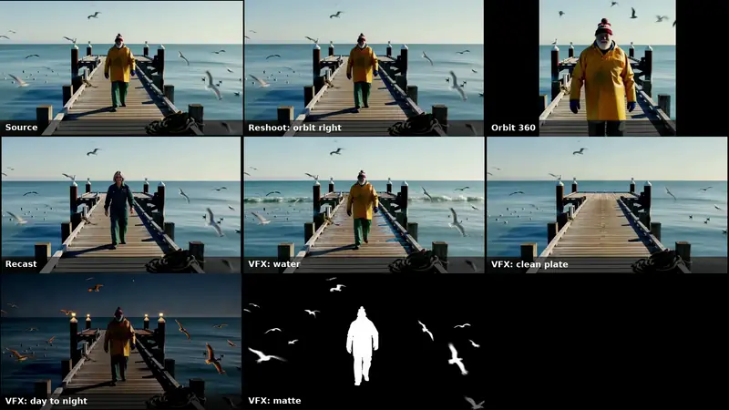
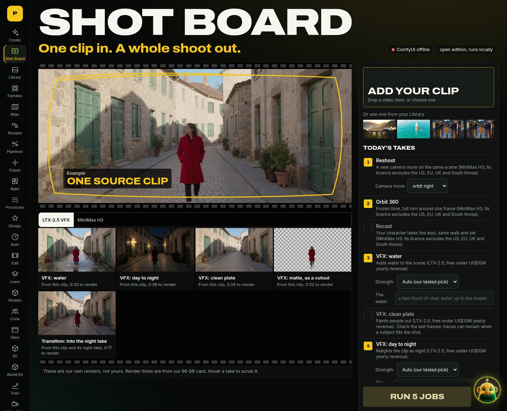
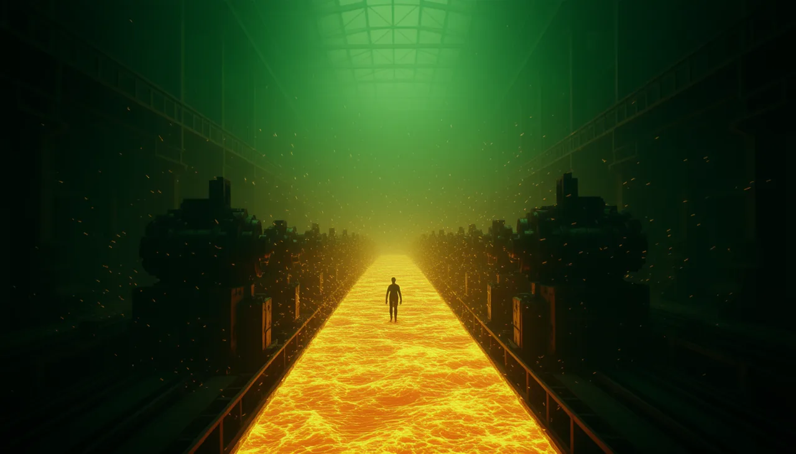
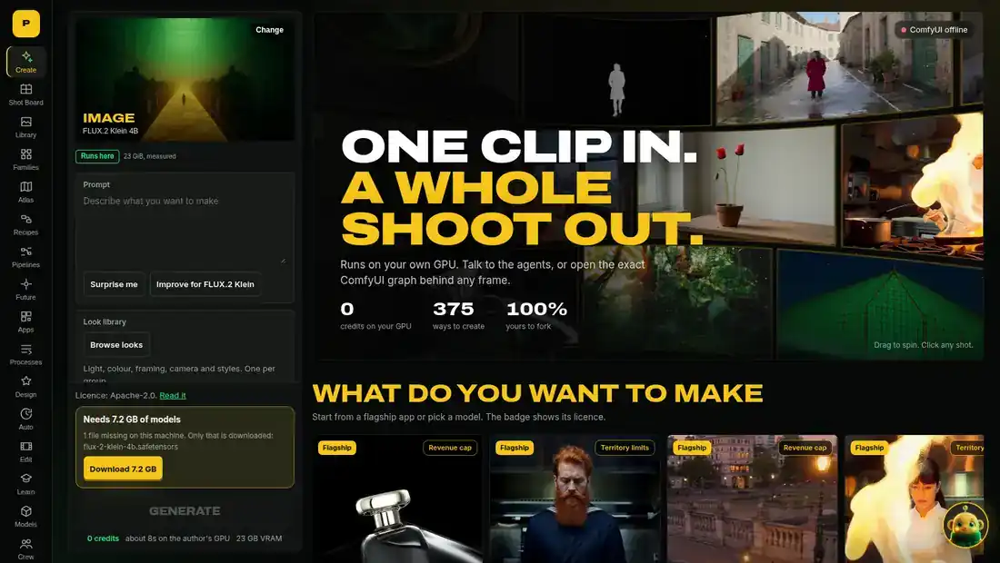
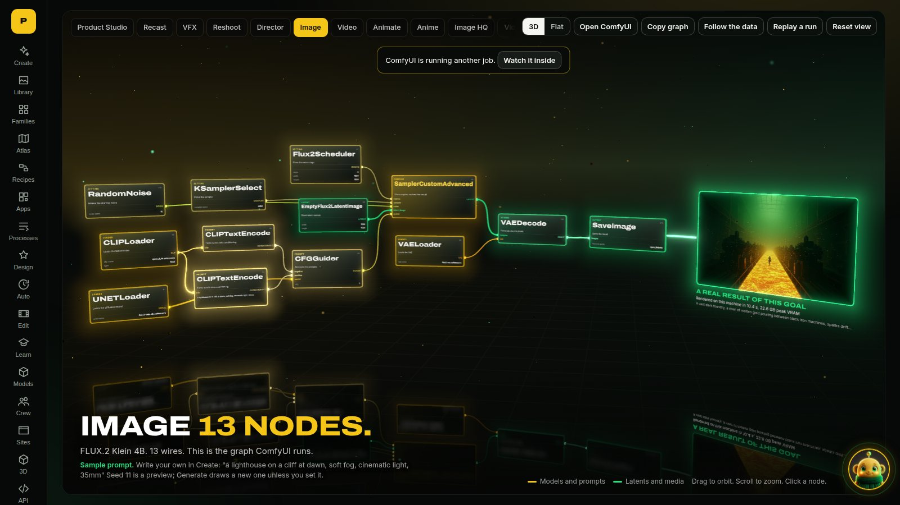
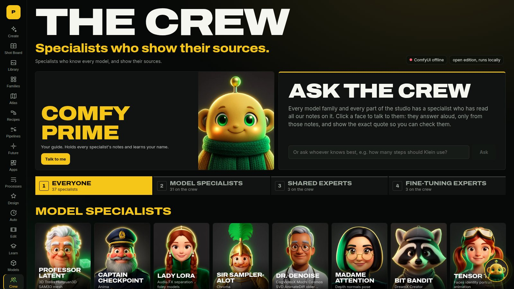
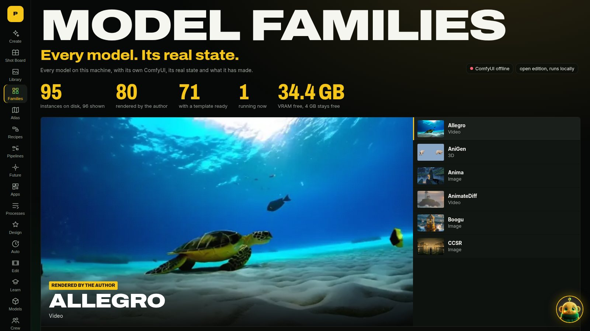
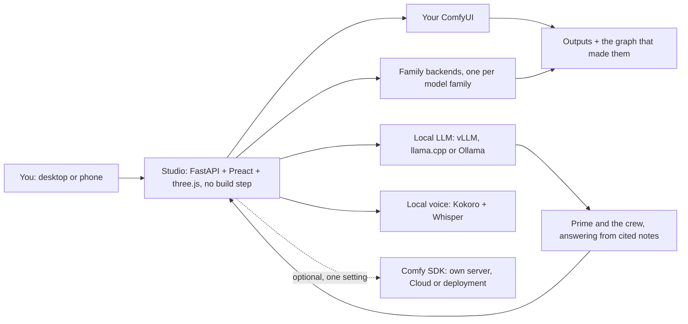

<div align="center">

# PARAMETRIC STUDIO

### One clip in, a whole shoot out, on your own GPU.

**[▶ Watch the Shot Board demo (1:49)](docs/media/shotboard_demo.mp4)** &nbsp;·&nbsp; **[Try the read-only demo](https://parametricparadigm.github.io/ComfyUI_Parametric_Studio/)** &nbsp;·&nbsp; **[⚡ Install](#install)** &nbsp;·&nbsp; **[For the judges](#for-the-judges)** &nbsp;·&nbsp; **[✅ What's proven](#whats-proven)**
<!-- shot board demo link: for GitHub's inline player, drop docs/media/shotboard_demo.mp4 (4.3 MB) into a comment box on github.com and paste the user-attachments URL on its own line here -->

[](docs/media/shotboard_demo.mp4)

<sub>One real Shot Board run: the source clip and its seven results, from the contact video the board exported, scaled down. Click for the 1:49 screen recording of that run (waits sped up and labelled, captions, no sound).</sub>

</div>

Bring one clip and queue the shoot: a new camera, a frozen orbit, a recast lead, then LTX-2.5 for water, a clean plate, day to night and a matte. Jobs run one at a time on your GPU, at 0 credits. Every result keeps its exact ComfyUI graph and seed, and you can open that graph and copy it out. Every clip and image on this page is AI-generated.

- **Real graphs.** What you see in Pro is what ComfyUI runs, not a diagram of it.
- **Audited nodes.** We read all 544 custom nodes and published the result: 158 do real work, 364 are honest utilities or payload builders that load no model, and 22 don't work yet, [listed by name](docs/NODES.md#node-reference). We removed or renamed the ones that faked results.
- **Open weights only.** No partner nodes or closed APIs in the open edition, enforced by tests. Models keep their own licences, and some limit where or how you can use them. MiniMax H3's community licence excludes the US, EU, UK and South Korea: [read MODELS.md](MODELS.md) before you install those goals.

## For the judges

Built for the Open Source Higgsfield contest. Entered in **Open Weights Only** and **VFX Workflow Built with LTX**. Best Overall considers every entry.

| | |
|---|---|
| **What's new** | One clip becomes a whole shoot in one queue: reshoot, frozen-time orbit, recast, then four LTX-2.5 effects, and every result keeps its exact graph and seed. Code: the queue in [`studio/web/shotboard.js`](studio/web/shotboard.js), job states in [`shotboard_logic.js`](studio/web/shotboard_logic.js), the board in [`shotboard_view.js`](studio/web/shotboard_view.js), the contact-video export in [`studio/shot_board.py`](studio/shot_board.py). Tests: [`tests/test_shot_board.py`](tests/test_shot_board.py) |
| **Open Weights Only** | [`tests/test_open_edition_no_paid_apis.py`](tests/test_open_edition_no_paid_apis.py) checks every graph in [`workflows/`](workflows) and [`studio/family_templates/`](studio/family_templates) against the 322 partner node ids in ComfyUI 0.43.0 ([`tests/partner_node_ids.txt`](tests/partner_node_ids.txt)), and keeps paid API hosts and SDKs out of `psn/` and `psn_nodes/`. The open edition hides partner apps: [`tests/test_publication.py`](tests/test_publication.py) |
| **LTX is the core** | [`workflows/ltx25_vfx_api.json`](workflows/ltx25_vfx_api.json): 30 nodes, LTX-2.5 with one of four Lightricks IC-LoRAs, picked per effect in `VFX_EFFECTS` in [`studio/goals.py`](studio/goals.py): water, clean plate, day to night, matte |
| **Demo** | [1:49 screen recording of one real run](docs/media/shotboard_demo.mp4): waits sped up and labelled, captions, no sound |
| **Try it** | [Read-only demo](https://parametricparadigm.github.io/ComfyUI_Parametric_Studio/): the real UI and real renders, it generates nothing |
| **Install** | [Three lines if you already run ComfyUI](#install), or one installer command |
| **Hardware** | Tested only on one Linux box with a 96 GB card. See [Shot Board](#shot-board-one-clip-in-a-whole-shoot-out) for the peak VRAM we recorded |
| **What's run and what isn't** | [What's proven](#whats-proven) |

## Shot Board: one clip in, a whole shoot out

Bring one clip and queue the lot: reshoot it with a new camera, orbit around the subject, recast the lead from a single picture, then run LTX-2.5 VFX for water, a clean plate, day to night and a matte. Jobs run one at a time on your GPU. The queue survives a reload, but the tab does need to stay open. Every result keeps its exact graph and seed. Export the grid as one captioned contact video. Seven jobs on one clip took about 13 minutes on our 96 GB card. A clean plate can leave a small smear when the subject fills the frame, and the page says so.

**The four LTX-2.5 effects on one clip**, from the same run (source, water, clean plate, day to night, matte). All four use [`workflows/ltx25_vfx_api.json`](workflows/ltx25_vfx_api.json) with a different IC-LoRA:


**Peak VRAM** for the same goals rendered on their own on our 96 GB card: reshoot 49.3 GiB, VFX water 47.3 GiB, VFX clean plate 44.8 GiB, recast 36.3 GiB (recorded in [`studio/web/showcase/showcase.json`](studio/web/showcase/showcase.json)). These are peaks on a card with room to spare, not minimums. No smaller card has been tried.



## What's proven

Run on one Linux box with a 96 GB RTX PRO 6000. Nothing here has been run on Windows, macOS, AMD or a smaller card. One fresh install has rendered: a clean Ubuntu 24.04 Docker container on that same card, with only the NVIDIA driver passed in, following INSTALL.md. Its first picture, on the Anima goal, took 30 s once the software and the 9.2 GB of models were in place. Fresh installs of other goals and on other machines have not been tried.

| Feature | Run for real here | Not run yet |
|---|---|---|
| Shot Board | Full 7-job board and export. About 13 minutes, and the tab has to stay open | Other hardware |
| Train | Short real runs on SDXL, SD 1.5, SD3.5 Medium, FLUX.2 Klein 4B and 9B, FLUX.1 dev, Z-Image, Lumina 2, Wan 2.2 5B and LTX-2.5, each with its peak and an A/B we looked at. The effect ranged from strong (Klein 9B, Wan, LTX) to weak (Lumina, FLUX.1 dev). Wan and LTX trained on stills and were tested on one frame. Klein 9B used about 72 GB | Any base marked Not run, including MiniMax H3, Qwen-Image 2.1, HiDream-O1 and Music 3. FLUX.1 schnell and Krea 2 ran out of memory here. FLUX.3 Klein, Anima and ERNIE fail in ComfyUI's training node. Video motion |
| Virtual Set | Blender passes on the CPU. Modes A (H3 and LTX-2.5), B, C and D rendered once each on one street shot | Wan, a pose pass, Qwen keyframes, any other shot |
| World Kit | Places, looks, library, Godot export, a prop from a mesh, on the CPU with Blender. A character from words to a rigged, moving, textured figure | Other steps that need a model (tested with fakes) |
| Recipes | 2 of 10 flagships rendered. A library of 740 passes an offline format check, and 674 of its recipes show a result we rendered here (480 pictures, 126 clips, 48 sounds, 20 3D models), each from one run. The sounds were checked for level and length, not listened to. More renders are on the way | The other 8 flagships and the rest of the library |
| Sampling Lab | 44 renders on SDXL, SD 1.5 and SD 3.5, and core sampler measurements | Pack entries are read from source, not run |
| RES4LYF page | A credit page. The pack is not shipped; run separately, of 154 nodes checked 92 rendered, 14 ran and 44 errored | The other nodes in the pack |
| Families | 95 wired, 61 with a render on record | The other 34 have no render on record. World Kit and Virtual Set extras are not in the installer yet |

## Install

**Already run ComfyUI?** You only need the studio, and a link so ComfyUI loads its `PSN_` nodes:

```bash
git clone https://github.com/parametricparadigm/ComfyUI_Parametric_Studio.git && cd ComfyUI_Parametric_Studio
python3 -m venv .venv && . .venv/bin/activate
pip install fastapi "uvicorn[standard]" python-multipart pydantic numpy pillow brotli apscheduler "huggingface_hub[hf_xet]"
ln -s "$PWD" /path/to/ComfyUI/custom_nodes/comfyui_parametric_studio    # then restart ComfyUI
COMFYUI_URL=http://127.0.0.1:8188 python -m studio.server               # open http://127.0.0.1:8310
```

With uv instead: `uv sync`, then `COMFYUI_URL=http://127.0.0.1:8188 uv run python -m studio.server`. On Ubuntu, get uv with `sudo apt install pipx && pipx install uv`; a plain `pip install uv` fails there.

Each app's page lists the model files it is missing and any node your ComfyUI doesn't have. The Shot Board needs MiniMax H3 for reshoot, orbit and recast, LTX-2.5 with four Lightricks IC-LoRAs for the VFX, and the ComfyUI-LTXVideo and KJNodes packs. The files, sizes and hashes for each goal are in [`studio/models_manifest.json`](studio/models_manifest.json) (goals `reshoot`, `orbit360`, `recast`, `vfx_ltx`), and the licences are in [MODELS.md](MODELS.md). Folder settings are in [INSTALL.md](INSTALL.md#using-a-comfyui-you-already-have).

**Starting from nothing?** One command, sized to your machine. See what it would do first:

```bash
sudo apt update && sudo apt install -y git ffmpeg python3-venv   # Ubuntu or Debian; other systems are in INSTALL.md
git clone https://github.com/parametricparadigm/ComfyUI_Parametric_Studio.git
cd ComfyUI_Parametric_Studio
python3 install.py --dry-run     # shows what fits this box and the disk it needs, changes nothing
python3 install.py               # or --goals anime for the smallest download, --channel nightly, --goals image,video
```

It needs a GPU driver already installed, and about 10 GB of disk plus the models: 25 GB is enough for the default goal. Then run the launcher it prints and open http://127.0.0.1:8310.

Full install on a clean Ubuntu 24.04 box: about 29 min to the studio page (PyTorch is ~3 GB), first image about 30 s once the models are in. Model download time depends on your Hugging Face speed.

**For the Shot Board:** `python3 install.py --goals reshoot,orbit360,recast,vfx_ltx --include-gated`. LTX-2.5 and its IC-LoRAs are gated: accept each licence on Hugging Face and set `HF_TOKEN` first. On our box, the dry run of that command plans 99.9 GB of models and about 110 GB of disk, and adds the ComfyUI-LTXVideo and KJNodes packs. It has not been run end to end on a clean machine.

Full details, including Windows, Mac and what has and hasn't been tested on each, are in **[INSTALL.md](INSTALL.md)**. Models and their licences are in **[MODELS.md](MODELS.md)**; they are not in this repo, and some have their own terms and regional limits. MiniMax H3's licence excludes the US, EU, UK and South Korea, and that reaches its outputs too, so read it before you install those goals.

---

## Also in the box

The Shot Board is the contest entry. The rest of the studio comes with it.

### Why this exists

Closed AI video apps give you a prompt box and hide everything else. ComfyUI gives you everything, and a blank canvas. **Parametric Studio is both at once:** a form anyone can use, and one click from the exact ComfyUI graph that made the result. It runs on your machine, it reads your machine, and it teaches you how it all works while you use it.

| | Closed creative suites | Parametric Studio |
|---|---|---|
| **Cost per render** | Credits | **0 on your own GPU** |
| **How a result was made** | Hidden | **The real graph, in 3D** |
| **Which models** | The ones they sell you | **95 families wired, 61 with a render on record** |
| **Your files and prompts** | On their servers | **Stay on your machine** |
| **Help** | A docs page | **A crew of characters that answer from cited notes, out loud** |
| **Can you fork it?** | No | **Yes: AGPL-3.0** |

### The apps

Named after what you want to do, not which node to wire.

| App | What it does | Core model |
|---|---|---|
| **Recast** | Swap the character in a video and keep the performance, scene and sound | MiniMax H3 |
| **VFX** | Flood a street, clear a plate, turn day to night, pull a matte | LTX-2.5 with IC-LoRAs |
| **Director** | Direct a shot like a film set: camera move, lens, light, mood, first and last frame | MiniMax H3 |
| **Reshoot** | A new take of your clip with a new camera move, from its first frame | MiniMax H3 |
| **Product Studio** | Your product, shot like an ad: pick the set and the light | FLUX.3 Klein |
| **Music Video Maker** | A song, the shots and the cut, on the beat | MiniMax Music 3 + H3 |
| **One sentence to a short film** | Plan, character, shots, score and edit from a single line | Klein + H3 + Music 3 |

Plus Image, Image HQ, Anime, Video, Animate, Video + Sound and Music as direct goals on FLUX.2 Klein, FLUX.3 Klein, Anima, Wan 2.2, LTX-2.5, MiniMax H3 and MiniMax Music 3.

<table><tr>
<td><a href="studio/web/showcase/v_h3_dragon.mp4"></a><br><sub><b>MiniMax H3</b>: dragon, with sound</sub></td>
<td><a href="studio/web/showcase/vfx_flood.mp4"></a><br><sub><b>LTX-2.5 VFX</b>: flood the street</sub></td>
<td><a href="studio/web/showcase/recast_chef.mp4"></a><br><sub><b>Recast</b>: same scene, new character</sub></td>
</tr><tr>
<td><br><sub><b>Anima</b>: mecha in the rain</sub></td>
<td><br><sub><b>FLUX.2 Klein</b>: 10 seconds on one GPU</sub></td>
<td><a href="studio/web/showcase/vfx_clean_plate.mp4"></a><br><sub><b>LTX-2.5 VFX</b>: the violinist painted out, no mask</sub></td>
</tr></table>

<sub>Every image above is a real, unedited, AI-generated output from this repo's workflows. Prompt, time and peak VRAM are on each tile in the app.</sub>

<div align="center">



<sub>That wall is video from this studio's own renders, curved around you in three.js. Drag it. Click any shot to see how it was made.</sub>

</div>

### See inside every shot
Open **Pro** and the exact ComfyUI graph appears in 3D, with data flowing along its wires. Click a node for a plain-language explanation. During a render it lights up node by node. The same graph runs when you press Generate, and you can copy it into ComfyUI.



### A crew you can talk to
**Comfy Prime** greets you, learns your name, and drives the studio for you, but never starts a render without your say. 37 specialists answer questions **only from notes, and show the quote**; this needs a local language model, and our tests stub it. Push to talk with local Whisper, hear replies in local Kokoro voices. Nothing leaves your machine.



### Model families, each with its own backend
95 families are wired, and 61 have a render on record. They run from **Stable Diffusion 1.5, SDXL and SD3** through **FLUX, Wan, HunyuanVideo, Mochi, LTX and MiniMax H3**, plus 3D, audio and utility models. Each has its own isolated ComfyUI instance with its own custom nodes and model view, started on demand behind a VRAM check and stopped when idle. Each family shows its state: rendered, ready, or what to download. Most family weights are not on our box any more, so a family with no render on record is wired, not proven.



### Designers
Whole concept sheets from a few choices: **Character, Fashion, Vehicle**, plus setting, animal, plant, hair, nails, furniture, costume and print-on-demand products. Original designs only: no brands, logos or real makes.

### AI video editing
Remove objects, upscale, slow motion, extend a clip, restyle with pose or depth, change the camera, fill and outpaint, edit by instruction, then cut it together on a timeline.

### Train: your pictures in, a LoRA out

The Train page drops or imports pictures, checks their captions, and trains a LoRA, through ComfyUI's own training nodes (`TrainLoraNode`) or an external trainer the page drives as a process. Each base says who trains it, what file it needs, its licence and whether it is **Proven** (a real run on record), **Not run** (everything is here, the first run is the test, and you tick a box to try it) or **missing pieces** (it names exactly which). The loss curve, speed and peak VRAM come from the run; a figure that was not measured is not shown. The result lands in the LoRA folder and in the page's LoRA search, with a same-seed A/B against the base.

Short runs prove the plumbing, and the page says so. In our proofs the LoRA usually changed a picture close to its training set and did little for the trigger word alone on a new subject. Some were weak, and the page's example says which.

The word check covers captions, file names, the LoRA name, the trigger and the test prompt. **Pictures are not checked: there is no image classifier yet**, so training needs a tick that you own or have rights to the pictures and that no real person's likeness is trained without consent. This is not a safety guarantee. ComfyUI's node saves only at the end, so a cancel or crash loses that run; Continue adds steps to a finished LoRA without the optimizer's state. External trainers save as they go, show their own samples and can resume from their last save.

**Installing ai-toolkit (for FLUX.1 dev, Qwen-Image 2.1, HiDream-O1, LTX-2.5 and MiniMax H3) or SimpleTuner (for Music 3):** nothing is installed for you. Clone https://github.com/ostris/ai-toolkit, make a Python 3.12 venv, install a CUDA build of torch and then `requirements.txt`, and set `STUDIO_TRAINER_AI_TOOLKIT_DIR` and `STUDIO_TRAINER_AI_TOOLKIT_PYTHON` (for SimpleTuner, install it in its own venv and set `STUDIO_TRAINER_SIMPLETUNER_PYTHON`). The page shows these steps on any base that needs it. We write the job file from our own templates in `studio/train_configs` and give the trainer a folder of links, so it never writes into your model folders. It may fetch tokenizer and config files from Hugging Face. `STUDIO_TRAIN_WRAP` puts a command in front of the trainer, for a machine that shares its GPU through a queue. `STUDIO_TRAIN_PROVE=<base id>` lets one base have its first run without the page's tick.

### World Kit and Virtual Set
**World Kit** keeps one library of `.glb` places, props and characters with real scale and colliders, and exports a Godot pack. The place maker, looks, library and export ran here on the CPU with Blender, and the prop maker ran from a mesh. Describe an invented person and the character maker makes a sheet, checks it, and builds a rigged body with motions: it ran here on real models. The figure wears the sheet's clothes, hair and colour; its back and sides are the model's guess. Word checks and a picture check run on every character; the page says what they cannot catch. Other steps that need a model are written and tested with fakes, but have not run on a real model.

**Virtual Set** blocks a shot in a real-scale 3D place and steers a video model with what Blender renders. The passes ran on the CPU, and modes A, B, C and D have each rendered once on one street shot. Wan, a pose pass and Qwen keyframes have not run. World Kit and Virtual Set need extra downloads the installer does not fetch yet; the page says what is missing.

### Motion: words in, a body moving
Make a character move from words with Kimodo and put the clip on a rigged World Kit character, make a person follow a performance, animate a portrait, lip-sync a clip, capture motion from video into a rig. Each route shows only what rendered here, with its seed, time, peak VRAM, licence and faults. Anything that shows a person asks you to confirm they are invented or gave permission, runs word and picture checks, and marks the result as AI-generated. Those checks can't tell a real person from an invented one: that part is your word, and it stays with the file.

### Sampling Lab and the RES4LYF page
**Sampling Lab** explains samplers and schedulers in plain words, with 44 real renders on SDXL, SD 1.5 and SD 3.5 and measurements of ComfyUI's core code. The atlas entries for third-party packs are read from their source, not run. The SD 3.5 renders were decoded with a preview VAE, so they are not final quality.

**RES4LYF** is a credit page for ClownsharkBatwing's pack, which we don't ship. Run separately, of 154 nodes checked, 92 rendered, 14 ran, 44 errored and 4 were skipped or refused. The rest of the pack was not tried.

### ComfyUniversity
Learn ComfyUI by doing it, in tracks from your first wire to reading the sampler's source: graphs, samplers, noise and latents, guidance, conditioning, ControlNet and depth, LoRA training, video, audio, 3D, custom nodes, debugging, VRAM, and vetting node packs. Each lesson has a graph you can download and open, a lab that runs in the browser with no GPU, a Python lab you can run on your CPU from the page, a quiz, and a section on what commonly goes wrong. Each one lists what we checked against ComfyUI's source, a run or official docs, and what we could not check. Every graph passes ComfyUI's own validation, the ones that need no model were really executed, and the browser's schedulers and solvers are tested against ComfyUI's real functions. Each lesson carries a mark worked out from the data: *second reader checked* if an independent audit has tried to prove it wrong and fixed what it found, or *author-checked, second read pending* if not. Second reads found and fixed real errors, and they sample each lesson's riskiest claims rather than prove it, so a few mistakes may remain. The page counts both marks and the errors fixed. Most lessons have not been run against a real model on a GPU, and they say so. Progress stays in your browser.

### Atlas: the history of generative AI
More than 130 models across 8 eras, from the first VAEs and GANs to today: what each was, why it mattered, its licence, whether it runs here, and a button to use it.

### Recipes and processes
**Recipes** chain models into one click and pass each output along to the next model. 2 of the 10 flagships have been rendered. The library of 740 (621 prompt recipes and 119 LoRA settings) passes an offline format check. 674 of its recipes show a result we rendered here (480 pictures, 126 clips, 48 sounds, 20 3D models), each from one run, and more renders are on the way. Without rendering, the page can also read each recipe against your ComfyUI's nodes and your model files. On our box 154 passed that, and most of the rest wait on a model file. **Processes** lists 97 methods, most with guides. Many guides were written for the earlier studio and say so at the top. Most entries open a real tool or family page here today; the rest are marked Coming soon.

### Apps: every graph in one place
The 18 studio graphs, the recipes, 53 family templates and ComfyUI's own app templates when that package is installed, searchable, each one click from its form. If a graph needs a model you don't have, its page says what to download.

### It reads your box
The installer and planner look at your GPU, RAM and disk and offer what fits: GPU, offload, or not on this machine. **Calibrate** runs a small test render of seven goals, twice each, and shows the cold and warm seconds on this box. It does not measure VRAM, and the planner does not use the result yet. The crew's own LLM is picked by tier, from a 2B model on a CPU to a 27B model on a big card, with exact GGUF files and settings. Choose **stable or nightly** ComfyUI at install.

### Runs your way
- **Press Download:** each app shows what it needs and fetches only that. No 500 GB surprise.
- **Attach your ComfyUI:** already have one? Point the studio at it.
- **Set and forget:** schedule creations with cron, on idle only.
- **On your phone:** add it to your home screen over Tailscale, with private HTTPS and a QR code. Your GPU does the work.
- **Comfy SDK:** the default is your local ComfyUI. With the `sdk` extra installed, set `STUDIO_BACKEND=sdk` to send the same graphs through Comfy's official SDK, to Comfy Cloud, a deployment or your own proxy. Cloud and deployments spend Comfy credits. Uploads and the Create button still need a local ComfyUI. This path is tested against a stubbed SDK, not yet against a live server.

### 544 custom nodes, including a new V3 pack
Audited by reading the code: 158 do real work on images, latents, audio or files, or call a service. 262 are honest utilities (maths, text, config) and 102 build a plan or a payload for something else; those load no model and render nothing. 22 do not work on real ComfyUI inputs yet ([list](docs/NODES.md#node-reference)). Node ids that changed are in [NODE_RENAMES](docs/NODE_RENAMES.md). The `PSN_` nodes load in about 0.07 s thanks to lazy imports. The new V3 flagship pack has seven nodes for your own graphs; the studio's built-in graphs don't use them yet. The main ones:

| Node | What it does |
|---|---|
| **VRAM Gate** | Stops a graph with a plain reason when free VRAM is too low, instead of crashing mid-render |
| **Director Prompt** | Pick a camera move and its own controls appear; composes the whole shot |
| **Recast Prompt** | Writes the reference-tagged swap instruction for H3 |
| **Shot List** | Grows one slot per shot, then expands into a render subgraph for each |
| **Latent Inspector** | Look inside a latent: channel grid, PCA colour, histograms, stats |
| **Graph Proof** | Saves a hash and the settings next to every output |

More in [docs/NODES.md](docs/NODES.md).

## How it fits together



| Folder | What lives there |
|---|---|
| `studio/` | The app: API, goals, recipes, crew, university, designers |
| `studio/web/` | The front end: Preact, htm and three.js, vendored, with no build step |
| `workflows/` | The API-format ComfyUI graphs behind every app |
| `psn_nodes/` | The custom node pack |
| `psn/` | Family instances, agents, connectors |
| `tests/` | More than 4,000 tests |

## Credits

**Made by Parametric Paradigm.**

**Made on one box:** NVIDIA RTX PRO 6000 Blackwell Workstation Edition (96 GB), AMD Ryzen 9 9950X 16-Core Processor (32 threads), 123 GB RAM, 4 TB NVMe, Ubuntu 24.04.5 LTS. Every render in this repo came from that one machine, except the samples marked as coming from ComfyUI's library.

Built with [ComfyUI](https://github.com/comfyanonymous/ComfyUI). Recast builds on the method published by Comfy-Org in `comfy-openjutsu` and Akatz Labs' H3 Character Swap. Thanks to every team that releases open weights: see [docs/CREDITS.md](docs/CREDITS.md) and [THIRD_PARTY_NOTICES.md](THIRD_PARTY_NOTICES.md).

## Licence

Powered by MiniMax H3. **AGPL-3.0-or-later.** Use it, fork it, improve it. If you ship or host a changed version, you share your source too. See [LICENSE](LICENSE). Models keep their own licences.
